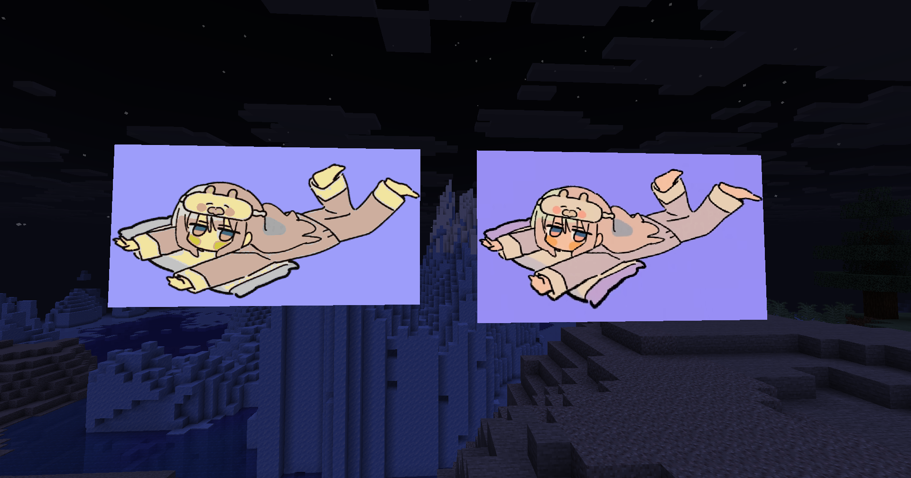
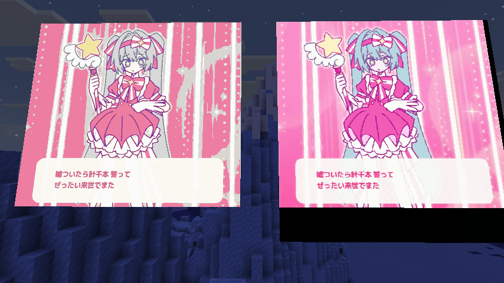
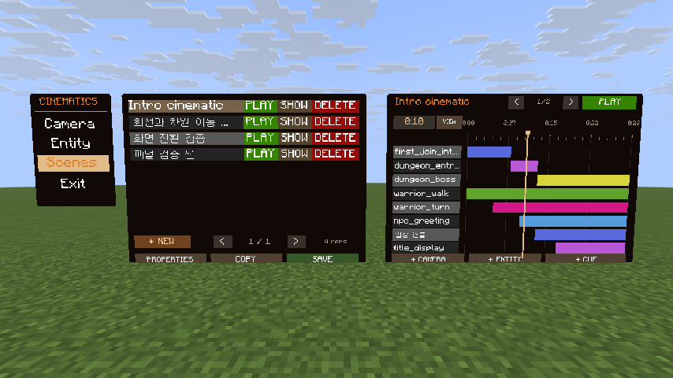
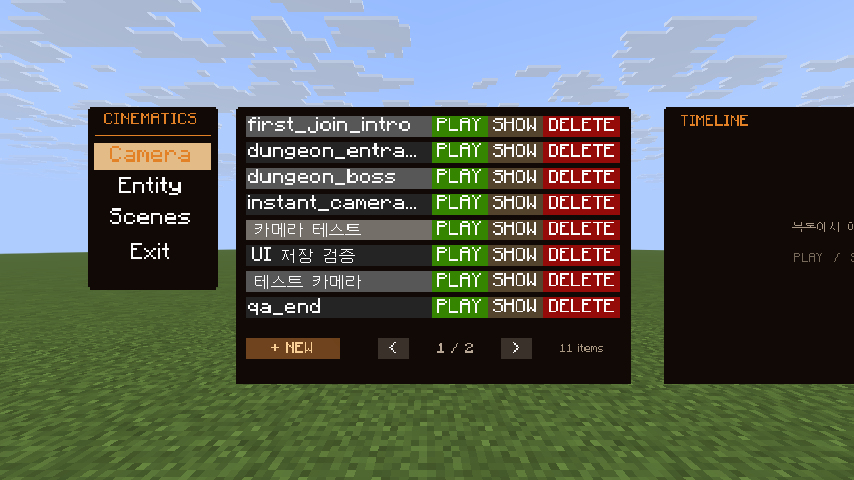
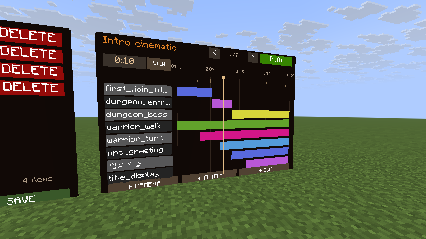
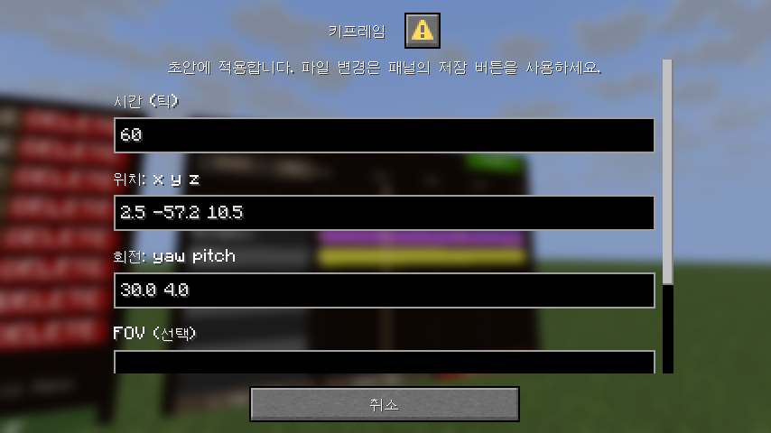

# Minigame Lib

Fabric **Minecraft 26.3**·Java 25 서버 라이브러리입니다. 시네마틱, 공간 편집기, OGG 음악과 기존 DisplayHUD·RGBMapUtils·ShaderFX·FOV를 제공합니다. 플레이어에게는 전용 클라이언트 모드 없이 Polymer 리소스팩을 전송합니다.

## DisplayHud

출처 : https://github.com/dorondo0000/DisplayHUD (2.2 Beta 기준으로 포팅)

2.0.0(26.3)부터 DisplayHUD 2.x 구조를 따릅니다.

- HUD 엔티티는 월드에 추가되지 않는 가상 `Display`이며, 패킷으로만 소유자에게 보이고 플레이어 탑승(passenger) 패킷에 자동으로 합쳐집니다.
- `GlobalHud.text/item/block(id)`로 여러 플레이어가 공유하는 HUD를 만들고 `show/hide/remove`로 관리합니다.
- `setAboveHand(true)`: 손에 든 아이템 위에 그립니다(`minigamelib:above_hand_trigger` 아이템 모델 사용).
- `updateWhenDataChanged()`: 값이 바뀔 때마다 자동으로 메타데이터를 전송합니다. `removeWhenPlayerDied()`, `setGlowing()`, `TextDisplayHud.setOpacity(n, time)`/`setBackgroundColor()`를 지원합니다.
- 리스폰·차원 이동 시 HUD를 자동으로 다시 보냅니다.

```java
var hp = new TextDisplayHud();
hp.setText(Component.literal("HP 100"));
hp.setAlignment(DisplayHud.HudAlignment.LEFT);
hp.setLocation(-900, -480, 0); // 1920x1080 기준 화면 좌표
hp.spawn(player, "hp");

var banner = GlobalHud.text("round");
banner.getHud().setText(Component.literal("ROUND 1"));
banner.show(server.getPlayerList().getPlayers());
```

**주의(1.x와 호환되지 않는 기본값)**: `DisplayHudManager` 기본값이 `unit 100/100`, `1920x1080`, `alignmentGap 1_000_000`으로 바뀌었습니다(셰이더 `displayhud.glsl`과 일치). 1.x의 `unit 1`, `gap 10000` 기준 좌표를 쓰던 코드는 좌표를 다시 맞추거나 `DisplayHudManager.configure(...)`로 셰이더 값과 함께 바꿔야 합니다.


## RGBMapUtils

출처 : https://github.com/JNNGL/vanilla-shaders
https://github.com/biryeongtrain/RGBMapUtils





## ShaderFX

[](https://www.youtube.com/watch?v=3GpW_6qgs80)

## 설치와 이전

Fabric Loader 0.20.1+, Fabric API 0.164.0+26.3, Polymer 0.18.4+26.3을 서버에 설치하고 `minigame-lib-2.1.0+26.3.jar`를 추가합니다. Maven 좌표는 `kim.biryeong:minigame-lib:2.1.0+26.3`입니다.

```groovy
repositories { maven { url "https://repo.biryeong.kim/releases/" } }
dependencies { implementation include("kim.biryeong:minigame-lib:2.1.0+26.3") }
```

새 버전은 `gradle.properties`의 `mod_version`을 올린 뒤 `./gradlew publishToR2`로 게시합니다(빌드·테스트, R2 업로드, 공개 URL 확인까지 수행하며 rclone `r2` remote 설정이 필요합니다. 이미 게시된 버전은 덮어쓰지 않습니다). 클라이언트는 바닐라 26.3(OpenGL/Vulkan)이며 Polymer 리소스팩만 받으면 됩니다.

기존 Java import의 `kim.biryeong.dantashader`를 `kim.biryeong.minigamelib`로, 리소스 ID의 `dantashader:`를 `minigamelib:`로 변경하세요. 모드 ID는 `minigamelib`입니다. 기존 `shaderfx.json`은 새 `config/minigame-lib/shaderfx.json`이 없을 때 가져옵니다. 원본은 남겨 둡니다.

회전 전용 마커·후처리 셰이더와 `CameraEffects.setCameraRotation/resetCameraRotation` API는 제거했습니다. 시네마틱은 빈 `item_display`의 위치·yaw·pitch를 사용합니다. Fabulous 설정과 회전 셰이더가 필요하지 않습니다. roll은 지원하지 않습니다.

## 시네마틱과 편집

[시작과 조작](#editor-start) · [왼쪽 메뉴](#editor-navigation) · [목록과 저장](#editor-browser) · [입력 창](#editor-dialogs) · [공통 타임라인](#editor-timeline) · [Camera](#editor-camera) · [Entity](#editor-entity) · [Scenes와 큐](#editor-scenes) · [처음부터 만들기](#editor-tutorial) · [저장과 문제 해결](#editor-storage)



왼쪽은 종류를 선택하는 메뉴, 가운데는 해당 종류의 목록, 오른쪽은 선택한 항목의 타임라인입니다. 이미지의 항목은 로컬 검증용 예시이며, 새 서버에서는 직접 만들어야 합니다.

먼저 아래 용어를 구분하세요.

| 용어 | 의미 |
| --- | --- |
| **Camera** | 한 차원 안에서 카메라가 이동하고 회전하는 경로입니다. 위치·회전·FOV 키프레임을 저장합니다. |
| **Entity** | 연출용 몹이나 display의 종류와 움직임입니다. 카메라 경로와 별도로 만듭니다. |
| **Scenes** | Camera와 Entity를 언제 시작할지 연결하고 음악·화면 효과를 배치하는 완성된 시네마틱입니다. 명령어로 재생할 대상입니다. |
| **키프레임** | 특정 틱에서의 위치·회전 등 상태입니다. 두 키프레임 사이의 움직임은 보간으로 계산합니다. |
| **클립** | 씬에 배치한 Camera 또는 Entity 트랙의 참조와 시작 시간입니다. |
| **큐** | 특정 틱에 실행할 음악 시작·정지 또는 화면 효과입니다. |
| **이름 / ID** | 이름은 목록에 표시되는 글이며 한글·공백을 사용할 수 있습니다. ID는 파일명·트랙 참조·명령어에 사용하는 식별자입니다. 이름을 바꿔도 ID는 바뀌지 않습니다. |

시간 입력은 모두 **서버 틱**입니다. 정상적인 20 TPS에서 `20틱 = 1초`, `100틱 = 5초`, `200틱 = 10초`입니다. 타임라인의 짧은 시간 표시는 `분:초`이며, 입력 창에서는 정확한 틱을 지정합니다. 서버 TPS가 낮아지면 시네마틱 진행도 느려집니다.

<a id="editor-start"></a>

### 편집기 열기와 기본 조작

```text
/minigamelib cinematic editor
/minigamelib cinematic list
/minigamelib cinematic play <sceneId> [players]
/minigamelib cinematic stop [players]
/minigamelib cinematic view <dimension> <x> <y> <z>
```

| 명령 | 사용법 |
| --- | --- |
| `editor` | 실행자 앞에 개인 전용 편집기를 엽니다. 이미 열려 있다면 기존 편집기를 닫고 새로 엽니다. 저장하지 않은 초안은 사라집니다. |
| `list` | 저장된 Camera·Entity·Scene의 **ID**를 출력합니다. 아직 저장하지 않은 초안은 포함하지 않습니다. |
| `play <sceneId> [players]` | 저장된 씬을 처음부터 재생합니다. 대상 생략 시 자신에게, `@a`를 붙이면 모든 플레이어에게 재생합니다. |
| `stop [players]` | 대상의 시네마틱과 일시 정지 미리보기를 끝내고 원래 몸의 화면으로 복귀시킵니다. 편집기를 열어 두었다면 패널이 다시 나타납니다. |
| `view <dimension> <x> <y> <z>` | 현재 시선 방향으로 지정한 장소를 관전하는 진단 명령입니다. 씬이나 키프레임을 저장하지 않습니다. |

명령과 편집은 권한 레벨 2 이상이 필요합니다. `editor`는 플레이어가 게임 안에서 실행해야 합니다. 콘솔에서 `play`·`stop`을 사용할 때는 대상 플레이어를 지정하세요.

1. 앞과 옆에 패널이 들어갈 공간이 있는 곳에서 수평 방향을 보고 `editor`를 실행합니다.
2. 화면 중앙 조준점을 버튼에 맞추고 왼쪽 또는 오른쪽 클릭합니다. 조준한 버튼은 밝아집니다.
3. 패널은 처음 연 월드 위치에 고정됩니다. 오른쪽 타임라인이 멀면 옆으로 걸어가서 조작하세요. 패널은 플레이어를 따라다니지 않으며, 너무 먼 버튼은 클릭되지 않습니다.
4. 숫자·이름을 바꿀 때는 Minecraft 기본 Dialog 입력 창을 사용합니다. 항목이 많으면 창을 스크롤합니다.

패널과 경로 표시는 편집기 소유자에게만 보입니다. 다른 관리자는 자신의 편집기를 별도로 열 수 있습니다. 편집 중 다른 차원으로 이동하거나 접속을 종료하거나 편집 권한을 잃으면 편집기가 닫힙니다.

<a id="editor-navigation"></a>

### 왼쪽 메뉴: CINEMATICS

| UI | 의미와 조작 |
| --- | --- |
| **CINEMATICS**와 주황색 가로선 | 편집기 제목과 구분선입니다. 클릭 동작은 없습니다. |
| **Camera** | 카메라 경로 목록을 엽니다. |
| **Entity** | 연출용 엔티티 트랙 목록을 엽니다. |
| **Scenes** | 완성할 시네마틱 목록을 엽니다. |
| **Exit** | 편집기를 닫고 개인 패널·경로 표시·미리보기를 정리합니다. **저장하지 않은 모든 초안이 사라집니다.** |

현재 메뉴는 황갈색 배경과 주황색 글자로 표시됩니다. 다른 메뉴에 조준하면 같은 강조색이 나타납니다. 메뉴를 바꾸면 항목 선택과 시간 커서는 초기화되지만, 편집기를 닫기 전까지 각 항목의 초안은 유지됩니다.

<a id="editor-browser"></a>

### 가운데 목록: 항목 선택과 파일 작업



목록은 ID 순으로 정렬되며 한 페이지에 최대 8개를 표시합니다. 저장된 항목과 자신이 만든 미저장 초안이 함께 나옵니다. 회색 줄무늬는 행을 구분하고, 선택한 이름 칸은 갈색으로 바뀝니다. 긴 이름의 `...`는 표시만 줄인 것이며 실제 이름은 보존됩니다. `! <id>`로 나오는 항목은 파일을 정상적으로 읽지 못한 항목입니다.

| UI | 의미와 조작 |
| --- | --- |
| **항목 이름** | 편집할 항목을 선택하고 오른쪽 타임라인을 엽니다. 커서는 0틱으로 돌아갑니다. 전체 이름은 PROPERTIES에서 확인합니다. |
| **PLAY** · 초록색 | 그 행의 항목을 선택한 뒤 **0틱부터 자신에게 미리보기**합니다. 현재 초안도 반영됩니다. Camera는 해당 카메라 경로, Entity는 클릭할 때의 편집자 시점에 고정한 카메라에서 해당 배우, Scene은 연결된 전체 연출을 재생합니다. |
| **SHOW** · 갈색 | 그 항목의 키프레임 위치와 경로를 월드에 표시합니다. `◆ 숫자`는 키프레임과 틱, 작은 점은 보간된 경로입니다. 씬에서는 연결된 Camera·Entity 경로를 표시합니다. |
| **HIDE** · 주황색 | SHOW로 켠 해당 항목의 경로를 숨깁니다. 목록이나 실제 배우를 삭제하지 않습니다. 여러 항목의 경로를 따로 켜고 끌 수 있습니다. |
| **DELETE** · 빨간색 | 그 행을 선택하고 삭제 확인 창을 엽니다. 확인 창에서 적용하면 저장된 파일은 **즉시 삭제**됩니다. SAVE를 추가로 누르는 작업이 아닙니다. |
| **+ NEW** | 현재 메뉴 종류의 새 초안을 만듭니다. 기본 속성 창이 바로 열립니다. Camera·Entity는 0틱 키프레임 하나, Scene은 카메라 하나와 200틱 길이로 시작합니다. |
| **목록 아래 `<` / `>`** | 이전·다음 목록 페이지로 이동합니다. 오른쪽 타임라인의 페이지와 별개입니다. |
| **`1 / 2` 등의 표시** | 현재 목록 페이지 / 전체 페이지입니다. |
| **`10 items` 등의 표시** | 현재 종류의 전체 항목 수입니다. 자신의 미저장 초안도 포함합니다. |
| **PROPERTIES** | 선택한 항목의 이름·차원·길이·엔티티 종류 등을 바꿉니다. 이름을 선택한 뒤에 나타납니다. |
| **COPY** | 선택한 항목을 새 ID와 이름을 가진 초안으로 복제하고, 복제본을 선택합니다. 복제본에도 SAVE가 필요합니다. |
| **SAVE** | **선택한 항목 하나**를 JSON으로 저장합니다. 연결된 다른 트랙이나 다른 메뉴의 초안까지 한 번에 저장하지 않습니다. |

SHOW는 현재 편집자가 있는 차원의 경로만 표시합니다. 다른 차원의 경로를 켜도 지금 있는 월드에는 나타나지 않습니다. 배우의 모습·장비·애니메이션은 PLAY 또는 VIEW로 확인하세요.

<a id="editor-dialogs"></a>

### 입력 창: 속성·복제·삭제

모든 입력 창에서 **적용**은 입력값을 검사해 현재 작업에 반영하고, **취소**는 그 입력을 반영하지 않고 닫습니다. 속성·키프레임·클립·큐 변경은 초안에 반영되므로 파일에 남기려면 SAVE를 누릅니다. **삭제 확인 창의 적용은 파일을 즉시 삭제하는 예외입니다.**

`+ NEW`는 입력 창을 열기 전에 초안을 생성합니다. 따라서 그 창에서 취소해도 기본 이름의 새 초안은 목록에 남습니다. 필요 없으면 해당 행을 DELETE하거나 저장하지 않고 편집기를 닫으세요. 입력 오류가 나면 채팅의 `편집 실패: ...`를 확인하고 해당 창을 다시 여세요.

#### PROPERTIES: 이름과 속성

| 입력 항목 | 표시되는 종류 | 의미와 예시 |
| --- | --- | --- |
| **이름** (`name`) | 모두 | 목록과 트랙에 표시할 이름입니다. 예: `로비 입장 카메라`. 비워 둘 수 없습니다. |
| **차원** (`dimension`) | Camera·Entity | 트랙이 사용할 월드입니다. 오버월드·네더·엔드 등 서버에 있는 차원을 선택합니다. 한 트랙의 모든 키프레임은 이 차원의 좌표를 사용합니다. |
| **길이 (틱)** (`duration`) | Scene | 씬 전체 길이입니다. `100`이면 정상 TPS에서 5초입니다. 모든 클립 시작 시간과 큐의 틱보다 커야 합니다. |
| **type** | Entity | 바닐라 몹 또는 display의 엔티티 ID입니다. 기본값은 `minecraft:pig`. 예: `minecraft:zombie`, `minecraft:item_display`, `minecraft:block_display`, `minecraft:text_display`. |
| **아이템 ID** (`item`) | Entity | `item_display`에 표시할 아이템입니다. 예: `minecraft:diamond_sword`. 비우면 `minecraft:stone`입니다. 다른 종류에는 적용하지 않습니다. |
| **블록 ID** (`block`) | Entity | `block_display`에 표시할 기본 상태의 블록입니다. 예: `minecraft:gold_block`. 비우면 `minecraft:stone`입니다. 블록 상태나 NBT 명령 문법을 넣는 칸은 아닙니다. |
| **표시할 글** (`text`) | Entity | `text_display`의 일반 문자열입니다. 비우면 트랙 이름을 사용합니다. JSON 컴포넌트나 MiniMessage를 해석하지 않습니다. |

#### COPY: 복제

| 입력 항목 | 의미 |
| --- | --- |
| **id** | 새 파일과 명령어에 사용할 ID입니다. 기본 제안은 `<원본id>_copy`입니다. 영어 소문자·숫자로 시작하는 1~64자이며, 나머지에는 `_`, `-`, `.`도 사용할 수 있습니다. 연속된 `..`와 기존 항목의 ID는 사용할 수 없습니다. 예: `intro_camera`, `intro`. |
| **이름** (`name`) | 복제본의 표시 이름입니다. 원본과 다른 이름을 정하면 목록에서 구분하기 쉽습니다. |

새 항목은 `camera_...`, `entity_...`, `scene_...` 형태의 자동 ID를 받습니다. 원하는 ID로 저장하려면 COPY에서 ID를 정해 복제본을 SAVE하세요. 씬을 복제하면 **연결된 Camera·Entity ID는 그대로 유지**됩니다. 경로까지 독립적으로 수정하려면 트랙도 복제하고 복제한 씬의 연결 대상을 바꾸세요.

#### DELETE: 삭제 확인

`id` 칸에 나온 삭제 대상을 확인한 뒤 **적용**합니다. 칸의 값이 선택한 항목의 ID와 다르면 삭제되지 않습니다. 저장된 씬이 참조하는 Camera·Entity는 삭제할 수 없습니다. 먼저 해당 씬에서 연결을 바꾸거나 제거하고 씬을 SAVE하세요. 파일 삭제 후에는 이 편집기에 실행 취소 기능이 없습니다.

<a id="editor-timeline"></a>

### 오른쪽 타임라인: 시간과 미리보기



항목을 선택하지 않았을 때의 **TIMELINE** 제목과 안내 문구에는 편집 동작이 없습니다. 가운데 목록에서 이름을 선택하면 다음 UI가 나타납니다.

| UI | 의미와 조작 |
| --- | --- |
| **상단 항목 이름** | 현재 편집하는 Camera·Entity·Scene의 이름입니다. |
| **상단 PLAY** · 초록색 | **현재 커서부터** 선택한 초안을 재생합니다. 목록 행의 PLAY는 0틱부터 시작한다는 차이가 있습니다. |
| **시간 버튼** · `0:00` 등 | 현재 커서를 분:초로 표시합니다. 클릭하면 `시간 이동` 창이 열립니다. **시간 (틱)**에 정수를 입력하고 적용하면 정확히 그 틱으로 이동합니다. |
| **VIEW** | 현재 커서 시점의 카메라·배우·화면 효과를 계산한 뒤 일시 정지해서 보여 줍니다. 미리보기 음악은 재생하지 않습니다. 종료는 `/minigamelib cinematic stop`입니다. |
| **시간 숫자·작은 눈금** | 타임라인 전체 시간 범위입니다. **눈금 영역을 클릭**하면 그 지점으로 커서를 옮깁니다. 이 동작만으로 미리보기 화면으로 넘어가지는 않습니다. |
| **황갈색 세로선과 윗부분 손잡이** | 현재 시간 커서입니다. 여러 트랙의 같은 시점을 한 번에 읽기 위한 표시입니다. 위치는 눈금 클릭이나 시간 버튼으로 바꿉니다. |
| **회색 트랙 이름 칸** | Camera·Entity에서는 해당 키프레임 편집 창, Scene에서는 연결된 클립 또는 큐 편집 창을 엽니다. 빈 회색 칸은 남는 표시 공간입니다. |
| **색상 막대** | 트랙의 시간상 위치와 범위를 구분합니다. 색은 행 순서에 따라 반복되며, 특정 색이 항상 Camera나 음악을 뜻하지는 않습니다. 막대를 드래그해서 길이를 바꾸는 UI는 없습니다. |
| **씬 상단 `<` / 페이지 / `>`** | 씬 트랙이 8개를 넘으면 나타납니다. 한 번에 8개씩 이전·다음 트랙을 봅니다. 목록 아래의 페이지 버튼과 독립적입니다. |

Scene의 커서 범위는 `0`부터 `길이 - 1`틱입니다. Camera·Entity 단독 타임라인은 마지막 키프레임까지의 범위를 기준으로 하며 최소 100틱을 표시합니다. `분:초` 표시는 초 미만을 생략하므로 서로 다른 틱이 같은 글자로 보일 수 있습니다.

미리보기 중에는 패널이 숨겨집니다. PLAY는 끝까지 진행하면, VIEW는 정지 명령을 실행하면 몸의 화면과 편집기로 돌아옵니다. 새 PLAY를 실행하면 기존 재생을 정리하고 교체합니다. 중간 시점부터 재생할 때 이미 활성화된 음악 큐는 음원의 중간을 탐색하지 않고 **곡 처음부터** 시작합니다.

<a id="editor-camera"></a>

### Camera: 위치·회전·FOV 키프레임

Camera 타임라인의 **Position / Rotation / FOV**는 각각 위치·회전·시야각을 읽기 위한 행입니다. 세 행은 **동일한 키프레임 묶음**을 사용합니다. 어느 행에서 ◆를 클릭하든 해당 틱의 전체 키프레임을 편집합니다.

| UI | 의미와 조작 |
| --- | --- |
| **Position** | 월드 안의 카메라 위치입니다. 이름 칸을 누르면 현재 커서의 키프레임 편집 창을 엽니다. |
| **Rotation** | 카메라의 yaw·pitch 회전입니다. 같은 키프레임 편집 창을 엽니다. |
| **FOV** | 카메라 시야각입니다. 선택적 값이므로 모든 프레임에 지정할 필요는 없습니다. |
| **◆** | 실제로 저장된 키프레임입니다. 누르면 커서를 그 틱으로 옮기고 편집 창을 엽니다. |
| **+ CAPTURE** | 현재 커서에 편집자의 현재 위치·눈높이·yaw·pitch를 기록합니다. 같은 틱의 프레임이 있으면 교체합니다. FOV는 비어 있고 보간은 LINEAR인 새 프레임으로 기록됩니다. |
| **EDIT KEY** | 현재 커서의 상태를 입력 창으로 엽니다. 그 틱에 키프레임이 없으면 보간된 상태가 초기값이며, 적용 시 새 프레임을 추가합니다. |
| **DELETE KEY** | 현재 커서와 **정확히 같은 틱**의 키프레임을 초안에서 삭제합니다. 사이 시점을 선택했다고 가까운 프레임이 삭제되지는 않습니다. 첫 0틱 프레임은 삭제할 수 없습니다. |

CAPTURE는 버튼을 클릭하는 순간의 시선을 기록하므로 패널을 바라보는 방향이 들어갈 수 있습니다. 원하는 연출 방향은 EDIT KEY의 `회전`에서 조정하세요. 이동하며 자동으로 기록하는 녹화 기능은 없습니다.

#### 키프레임 입력 창



| 입력 항목 | 의미와 입력법 |
| --- | --- |
| **시간 (틱)** (`tick`) | 이 트랙 안의 프레임 시간입니다. 0 이상의 정수입니다. 기존 프레임의 시간을 변경하면 옛 시간에서 제거되고 새 시간으로 옮겨집니다. 새 시간에 이미 프레임이 있으면 교체됩니다. 0틱 프레임이 하나는 남아 있어야 합니다. |
| **위치: x y z** (`position`) | 차원 안의 **절대 좌표** 세 개를 공백으로 구분합니다. 예: `100 70 100`. 소수를 사용할 수 있습니다. `~`, `^` 같은 명령어 상대 좌표는 지원하지 않습니다. Camera에서는 카메라 자체의 위치입니다. |
| **회전: yaw pitch** (`rotation`) | 각도를 공백으로 구분합니다. 예: `90 10`. yaw는 수평 방향, pitch는 위아래 방향이며 `-90`~`90`입니다. pitch가 음수면 위, 양수면 아래를 봅니다. roll 입력은 없습니다. |
| **FOV (선택)** (`fov`) | `1 <= fov < 180`의 시야각입니다. 예: `70`. 작을수록 좁게, 클수록 넓게 보입니다. 비우면 해당 시점에서 새 FOV를 지정하지 않습니다. FOV를 부드럽게 바꾸려면 구간 양 끝에 값을 지정하세요. |
| **보간 방식** (`interpolation`) | `선형`(LINEAR), `부드럽게`(SMOOTH), `컷`(CUT) 중 선택합니다. **이 프레임으로 들어오는 구간**에 적용됩니다. 예를 들어 0틱에서 80틱까지 부드럽게 이동하려면 80틱 프레임에 SMOOTH를 설정합니다. |

LINEAR는 구간을 일정한 비율로 진행하고, SMOOTH는 시작과 끝의 변화를 완만하게 만듭니다. CUT은 직전 상태를 유지하다가 지정한 틱에서 바로 바꿉니다. yaw가 `179 → -179`로 바뀌면 최단 방향으로 회전합니다. 마지막 키프레임 이후에는 마지막 상태를 유지합니다.

**현재 눈금보다 뒤에 키프레임을 추가하려면:** 눈금 안에서 아직 프레임이 없는 틱을 고른 뒤 EDIT KEY를 열고, 창의 `시간 (틱)`을 원하는 더 큰 값으로 바꿔 적용하세요. 타임라인 범위가 새 마지막 프레임에 맞춰 늘어납니다. 단순히 0틱 프레임의 시간을 뒤로 옮기면 필수 0틱 프레임이 없어져 거절됩니다.

<a id="editor-entity"></a>

### Entity: 연출용 배우 만들기

Entity에서 **+ NEW**를 누르면 기본 돼지 트랙과 0틱 키프레임이 만들어집니다. PROPERTIES에서 원하는 몹·display 종류와 표시 내용을 정하고, Camera와 같은 방법으로 위치·회전 키프레임을 만듭니다. 실제 월드의 기존 엔티티를 선택하거나 변경하는 기능이 아니라 **시청자 전용 배우**를 만드는 기능입니다.

| 타임라인 UI | 의미 |
| --- | --- |
| **Position** | 배우의 절대 위치입니다. 일반적인 몹에서는 발밑 좌표입니다. |
| **Rotation** | 배우의 yaw·pitch입니다. |
| **Pose** | 해당 틱부터 적용할 바닐라 자세입니다. |
| **Equipment** | 해당 틱부터 적용할 장비입니다. |
| **◆ / + CAPTURE / EDIT KEY / DELETE KEY** | Camera와 같은 키프레임 조작입니다. 네 행은 하나의 키프레임 묶음을 공유합니다. |

Entity 키프레임 창에는 공통 위치·회전·보간 입력과 함께 다음 항목이 나옵니다.

| 입력 항목 | 의미와 예시 |
| --- | --- |
| **포즈** (`pose`) | 바닐라 Pose 이름입니다. 기본은 `STANDING`, 예시는 `CROUCHING`, `SLEEPING`입니다. 실제 외형 변화는 해당 몹·display가 지원하는 자세에 따라 달라집니다. |
| **애니메이션 (선택)** (`animation`) | 비우면 추가 동작이 없습니다. `swing_main_hand`는 주 손 휘두르기, `swing_off_hand`는 보조 손 휘두르기, `hurt`는 피격 연출입니다. 해당 키프레임 틱에 동작을 전송하며, 대상 종류에 따라 보이는 결과가 다릅니다. |
| **장비 JSON** (`equipment`) | 몹의 슬롯과 아이템 ID를 연결합니다. 예: `{"mainhand":"minecraft:diamond_sword","head":"minecraft:iron_helmet"}`. 일반 슬롯은 `mainhand`, `offhand`, `head`, `chest`, `legs`, `feet`입니다. `{}`는 장비 없음이며, 빠진 슬롯도 비워집니다. display에는 `{}`를 사용합니다. |

Entity 창에도 공통 항목인 FOV가 표시되지만 배우의 FOV는 시점에 적용되지 않습니다. 시야각 연출은 Camera 트랙에 설정하세요. 포즈와 장비는 위치처럼 보간하지 않고 해당 프레임의 상태로 바뀝니다.

Entity의 CAPTURE도 편집자의 **눈높이**를 기록합니다. 바닥에 서는 배우를 만들려면 EDIT KEY에서 Y를 발밑 높이에 맞추세요. 같은 틱을 CAPTURE로 교체하면 기존 포즈·애니메이션·장비 지정도 새 프레임의 기본값으로 교체되므로 필요한 값은 다시 입력합니다.

Entity의 단독 PLAY는 클릭할 때의 편집자 시점을 고정한 카메라에서 배우를 보여 줍니다. 원하는 구도로 확인하려면 Camera와 함께 씬에 연결하세요. 배우는 카메라가 배우와 같은 차원을 관전할 때 나타납니다.

<a id="editor-scenes"></a>

### Scenes: 트랙 연결과 음악·화면 큐

씬을 새로 만들려면 **저장된 Camera가 하나 이상** 있어야 합니다. Scenes → + NEW를 누르면 저장된 카메라의 ID 순 첫 항목이 0틱에 자동 연결되고 길이는 200틱으로 시작합니다. PROPERTIES에서 씬 이름·길이를 정하고, 첫 카메라 행을 눌러 원하는 트랙이 연결됐는지 확인하세요.

#### 씬의 트랙과 버튼

| UI | 의미와 조작 |
| --- | --- |
| **카메라 이름·막대** | 이 카메라가 시작하는 시점부터 다음 카메라의 시작 또는 씬 끝까지의 범위입니다. 이름이나 막대를 클릭해 트랙 연결과 시작 시간을 바꿉니다. |
| **엔티티 이름·막대** | 배우의 등장 시점부터 씬 끝까지의 범위입니다. 마지막 키프레임 뒤에는 마지막 상태로 남습니다. 이름이나 막대를 클릭해 연결을 편집합니다. |
| **MUSIC / STOP_MUSIC / TRANSITION / EFFECT 행** | 해당 종류의 큐입니다. 클릭하면 커서를 큐의 틱으로 옮기고 큐 입력 창을 엽니다. 음악 막대 길이는 실제 음원 길이가 아닙니다. |
| **+ CAMERA** | 현재 커서를 기본 시작 시간으로 하여 카메라 클립을 추가하는 창을 엽니다. 카메라 경로 자체를 새로 만드는 버튼은 아닙니다. |
| **+ ENTITY** | 저장된 트랙 또는 현재 초안의 Entity를 씬에 연결합니다. |
| **+ CUE** | 현재 커서에 음악·화면 효과 큐를 추가합니다. 그 틱에 큐가 이미 있으면 기존 큐를 편집합니다. |

트랙은 카메라 → 엔티티 → 큐 순으로 나옵니다. 씬 상단 페이지 버튼으로 나머지 행을 확인할 수 있습니다. 아주 짧은 막대가 클릭하기 어려우면 왼쪽 이름 칸을 사용하세요.

#### Camera / Entity 클립 입력 창

| 입력 항목 | 의미 |
| --- | --- |
| **트랙 선택** (`track`) | 연결할 Camera 또는 Entity입니다. 목록에는 저장된 트랙과 현재 편집기의 초안이 함께 나타납니다. 씬을 저장하기 전에는 참조한 트랙도 각각 SAVE해야 합니다. |
| **시작 시간 (틱)** (`start`) | **씬 전체 타임라인**에서 이 클립을 시작할 시점입니다. 0 이상, 씬 길이 미만입니다. |
| **작업** (`delete`) | `유지 / 추가`는 클립을 추가하거나 수정합니다. 기존 클립에서 `삭제`를 선택하면 씬의 연결만 제거하며 원본 Camera·Entity 파일은 남습니다. 변경한 씬을 SAVE해야 파일에 반영됩니다. |

카메라는 0틱에 하나가 반드시 있어야 하며 같은 시작 틱에 둘을 배치할 수 없습니다. 카메라가 바뀌는 시점은 컷입니다. 서로 다른 차원의 카메라도 별도 클립으로 연결하며 컷으로 전환합니다. 같은 차원에서 이동을 이어 보이게 하려면 한 Camera 안의 키프레임으로 연결하세요.

트랙의 키프레임 시간은 클립 시작으로부터 계산합니다. 예를 들어 **씬의 100틱에 시작한 카메라의 40틱 키프레임은 씬의 140틱**에 도달합니다. 엔티티 여러 개를 동시에 배치할 수 있으며, 같은 Entity·같은 시작 시간의 중복 클립은 허용하지 않습니다. 동일한 배우를 여러 개 만들려면 Entity 트랙을 COPY해서 연결하세요.

#### + CUE: 타임라인 큐 입력 창

| 입력 항목 | 의미와 입력법 |
| --- | --- |
| **시간 (틱)** (`tick`) | 씬 전체에서 실행할 시점입니다. 0 이상, 씬 길이 미만입니다. |
| **type** | `MUSIC`, `STOP_MUSIC`, `TRANSITION`, `EFFECT` 중 하나를 **텍스트로 입력**합니다. |
| **id** | 음악·플레이리스트 또는 화면 효과 ID입니다. 아래 종류별 표를 참고하세요. |
| **길이 (틱)** (`duration`) | TRANSITION·EFFECT가 보이는 기간입니다. 눈에 보이게 하려면 1 이상으로 지정합니다. 음악 시작·정지에서는 재생 시간을 제한하지 않습니다. |
| **색상 (RGB 16진수)** (`color`) | 화면 효과의 RGB 색상입니다. `000000`은 검정, `ffffff`는 흰색, `ff0000`은 빨강입니다. `#`나 `0x`를 붙이지 않습니다. 음악에서도 창에는 나오지만 소리에 영향을 주지 않습니다. |
| **작업** (`delete`) | `유지 / 추가`는 큐를 추가·수정하고, 기존 큐에서 `삭제`는 그 큐를 초안에서 제거합니다. 씬의 SAVE가 필요합니다. |

| type | id 예시 | 재생 결과 |
| --- | --- | --- |
| **MUSIC** | `all`, 사용자 플레이리스트 ID 또는 `/minigamelib music list`에 나온 곡 ID | 음악을 시작합니다. 새 MUSIC 큐는 이전 시네마틱 음악을 교체합니다. OGG 파일 경로를 그대로 넣지 말고 등록된 ID를 사용하세요. |
| **STOP_MUSIC** | 비워 둠 | 현재 시네마틱 음악을 정지합니다. `duration`은 0으로 두어도 됩니다. |
| **TRANSITION** | `minigamelib:transition-hbars` | 지정한 기간 동안 마스크가 열리며 화면을 드러냅니다. 예: 검정색·20틱이면 정상 TPS에서 약 1초의 전환입니다. |
| **EFFECT** | `minigamelib:fade` | 지정한 기간 동안 효과를 표시합니다. 이 `fade`는 기간 동안 단색 덮개를 표시하는 효과이며, 이름만으로 점진적인 페이드 인·아웃이 만들어지지는 않습니다. |

`minigamelib:fade`는 EFFECT, `minigamelib:transition-hbars`는 TRANSITION용 ID입니다. 종류와 ID가 맞지 않으면 재생이 거절됩니다. 음악은 OGG 추가 → Polymer 팩 생성 성공 → 청취자의 팩 적용 완료가 먼저 필요합니다. 자세한 등록 방법은 아래 [음악](#음악)을 참고하세요.

현재 UI는 같은 틱의 **첫 큐**를 편집합니다. UI로 작업할 때는 큐마다 서로 다른 틱을 사용하세요. 화면 효과가 시간상 겹치면 현재 활성 큐 중 더 나중에 시작한 큐가 표시됩니다.

<a id="editor-tutorial"></a>

### 처음부터 5초 시네마틱 만들기

아래 순서는 코드나 JSON 파일을 직접 작성하지 않고 UI로 `intro` 씬을 만드는 예입니다.

#### 1. 카메라 만들기

1. 연출할 차원에서 `/minigamelib cinematic editor`를 실행합니다.
2. **Camera → + NEW**를 누릅니다. 이름을 `인트로 카메라`로 정하고 차원을 확인한 뒤 **적용**합니다.
3. **EDIT KEY**를 눌러 첫 **0틱**의 위치·회전을 정합니다. 위치는 원하는 카메라 눈높이의 절대 좌표입니다. CAPTURE된 시선이 패널을 향하고 있으면 여기서 고칩니다. FOV는 예를 들어 `70`으로 정하고 적용합니다.
4. 타임라인의 **시간 버튼**을 눌러 `80`틱으로 옮긴 뒤 **EDIT KEY**를 엽니다.
5. 도착 위치·회전을 입력하고 보간을 **부드럽게(SMOOTH)**로 선택합니다. 예를 들어 시작이 `100 70 100`이라면 도착을 `108 73 106`, 회전을 `90 10`, FOV를 `60`으로 정할 수 있습니다. 자신이 연출할 월드에 맞는 좌표를 사용하세요.
6. **SAVE**를 누릅니다. 필요하면 **SHOW**로 경로를 확인하고 목록의 **PLAY**로 처음부터 시험합니다. 80틱까지 이동한 뒤 단독 미리보기의 남은 구간은 마지막 상태로 유지됩니다.

직접 이동해서 좌표를 가져오려면 원하는 커서를 선택한 뒤 그 장소로 가서 + CAPTURE를 사용할 수 있습니다. 패널이 멀어 클릭할 수 없거나 정확한 방향이 필요하면 EDIT KEY에 좌표·회전을 입력하세요. 작업 도중 `editor` 명령으로 새 패널을 열기 전에는 SAVE해야 합니다.

#### 2. 씬에 카메라 연결하기

1. **Scenes → + NEW**를 누릅니다. 이름을 `인트로 초안`, **길이 (틱)**을 `100`으로 정하고 적용합니다.
2. 오른쪽 **첫 카메라 트랙 이름**을 누릅니다. **트랙 선택**에서 `인트로 카메라`, **시작 시간** `0`, **작업** `유지 / 추가`로 적용합니다. 자동으로 선택된 다른 카메라가 있었다면 이 단계에서 교체됩니다.
3. 가운데 목록 아래 **COPY**를 누르고 ID를 `intro`, 이름을 `인트로`로 정해 적용합니다. `intro`가 이미 있으면 다른 새 ID를 사용하세요.
4. 복제본 `인트로`가 선택된 상태에서 **SAVE**합니다. 이후 작업에서는 원본 `인트로 초안`이 아닌 이 복제본을 선택합니다. 이 씬은 0~80틱에 카메라가 움직이고 나머지 구간에서 마지막 화면을 유지한 뒤, 총 100틱에서 끝납니다.

#### 3. 배우와 화면 전환 추가하기 — 선택

1. **Entity → + NEW**로 배우를 만들고 이름·차원·type을 정합니다. EDIT KEY에서 위치를 카메라가 볼 수 있는 곳으로 정합니다. 몹의 Y 좌표는 눈높이가 아닌 발밑 높이를 기준으로 입력합니다.
2. 필요하면 40틱 등 다른 시점에 키프레임과 장비·포즈를 추가한 뒤 Entity를 **SAVE**합니다.
3. **Scenes**에서 `인트로`를 선택하고 **+ ENTITY**를 누릅니다. 방금 저장한 배우, 시작 시간 `0`, 작업 `유지 / 추가`로 적용합니다.
4. 씬 커서를 **0틱**에 두고 **+ CUE**를 누릅니다. `type=TRANSITION`, `id=minigamelib:transition-hbars`, `duration=20`, `color=000000`, 작업 `유지 / 추가`로 적용합니다.
5. 음악까지 넣으려면 먼저 [음악 등록](#음악)을 마친 뒤 커서를 **20틱**으로 옮겨 별도 큐를 만듭니다. `type=MUSIC`, `id=all`, `duration=0`으로 적용합니다. 다른 화면 큐와 시작 틱을 나눠 두면 UI에서 각각 선택할 수 있습니다.
6. 변경한 **씬을 SAVE**합니다. Camera·Entity의 SAVE와 씬의 SAVE는 각각 필요합니다.

#### 4. 확인하고 플레이어에게 재생하기

1. 씬 목록 행의 **PLAY**로 처음부터 확인합니다.
2. 특정 장면만 확인하려면 이름을 다시 선택하고 시간 버튼으로 예를 들어 `40`틱을 고른 뒤 **VIEW**를 누릅니다. `/minigamelib cinematic stop`으로 돌아온 다음, 타임라인의 PLAY를 누르면 그 커서부터 재생합니다.
3. 마지막 변경까지 SAVE한 후 저장된 씬을 명령어로 재생합니다.

```text
/minigamelib cinematic list
/minigamelib cinematic play intro
/minigamelib cinematic play intro @a
/minigamelib cinematic stop @a
```

첫 play는 자신에게, `@a`를 붙인 play는 전체 플레이어에게 재생합니다. 실제 게임 시스템에서는 `lib.cinematics().play("intro", players)`로 같은 씬을 호출할 수 있습니다. 편집기 미리보기는 초안을 반영하지만 **명령어 재생은 저장된 파일을 사용**하므로 SAVE 여부를 확인하세요.

<a id="editor-storage"></a>

### 저장 위치와 자주 막히는 지점

```text
config/minigame-lib/cinematics/cameras/<id>.json
config/minigame-lib/cinematics/entities/<id>.json
config/minigame-lib/cinematics/scenes/<id>.json
```

정의의 `version`은 1입니다. Camera·Entity를 먼저 저장하고, 이를 참조하는 Scene을 나중에 저장하세요. 저장은 파일 하나를 원자적으로 교체합니다. 다른 관리자가 먼저 저장한 경우 자신의 오래된 초안으로 덮어쓰지 않고 충돌을 알립니다. 초안의 필요한 값을 따로 기록한 뒤 편집기를 다시 열어 최신 파일을 읽고 변경을 반영하세요.

| 상황 | 확인할 내용 |
| --- | --- |
| 버튼을 눌러도 반응이 없음 | 버튼에 가까이 가서 정확히 조준했는지, 편집 권한이 있는지 확인합니다. 패널은 처음 연 위치에 남아 있습니다. |
| 새 씬을 만들 수 없음 | Camera를 하나 이상 **SAVE**했는지 확인합니다. 미저장 카메라 초안만 있으면 새 씬을 만들 수 없습니다. |
| 항목을 만들었는데 보이지 않음 | ID 순 정렬 때문에 다른 목록 페이지에 있을 수 있습니다. `< / >`로 넘겨 보세요. |
| 새 프레임의 시간이 범위를 벗어남 | 시간 이동 창 대신, 기존 범위 안의 빈 시점에서 **EDIT KEY**를 열고 프레임의 시간 자체를 늘립니다. |
| 첫 프레임을 삭제하거나 이동할 수 없음 | 트랙에는 0틱 프레임이 반드시 있어야 합니다. 위치·회전만 수정하거나, 다른 빈 틱에서 새 프레임을 만드세요. |
| 첫 카메라 클립을 지울 수 없음 | 씬의 0틱에는 카메라가 하나 있어야 합니다. 첫 클립을 삭제하는 대신 트랙 선택으로 교체하세요. |
| SHOW를 눌렀는데 배우가 안 보임 | SHOW는 경로 표시입니다. 실제 배우는 PLAY·VIEW로 확인하고, 카메라와 배우의 차원도 맞춰야 합니다. |
| 씬에서 트랙을 골랐지만 SAVE가 실패함 | 참조한 Camera·Entity가 파일로 저장됐는지, 클립·큐의 시작이 씬 길이 안인지 확인합니다. |
| `다른 관리자가 저장했습니다` | 현재 초안이 오래되었습니다. 최신 파일을 다시 읽고 수정해야 합니다. 현재 편집기를 재실행하면 미저장 초안이 사라집니다. |
| 카메라·배우 DELETE가 거절됨 | 저장된 씬에서 참조 중인지 확인합니다. 연결을 변경한 씬을 먼저 SAVE합니다. |
| 미리보기와 명령어 재생 결과가 다름 | 미리보기에는 초안이 반영됩니다. 변경한 트랙과 씬을 각각 SAVE했는지 확인합니다. |
| 음악이 들리지 않음 | 곡·플레이리스트 ID, OGG 검색과 팩 빌드 성공, 플레이어의 팩 적용 완료를 확인합니다. 도중에 준비된 청취자는 다음 곡부터 합류합니다. |
| 미리보기 중 패널이 없어짐 | 미리보기 화면에서는 패널을 숨깁니다. `/minigamelib cinematic stop`으로 복귀합니다. |

재생 중 실제 플레이어의 위치·차원·게임 모드는 유지됩니다. 종료 시 현재 서버 상태와 이전 FOV를 다시 동기화합니다. 초기 관전 청크 준비는 최대 15초 기다리며 준비 실패 시 복귀합니다. 다른 차원으로 이어지는 연출은 별도 Camera 클립과 컷을 사용하세요.

## 음악

`config/minigame-lib/music` 아래에 OGG Vorbis 파일을 넣고 Polymer 리소스팩을 다시 생성하세요. 하위 폴더와 한글·공백 이름을 지원합니다. 길이는 Vorbis 샘플 수에서 읽으며 서버에 FFmpeg가 필요하지 않습니다. 손상 파일, Vorbis가 아닌 코덱, 다중·연결 Ogg 스트림은 경로와 이유를 기록하고 제외합니다.

```text
/minigamelib music list
/minigamelib music play <trackId|playlist> [players]
/minigamelib music stop [players]
/minigamelib music next [players]
/minigamelib music global play <trackId|playlist>
/minigamelib music global stop
/minigamelib music global next
```

팩 생성 성공 후에만 목록이 바뀝니다. 전송마다 별도 UUID를 사용해 이전 팩의 늦은 완료 응답이 새 팩을 승인하지 못하게 하고, 완료 응답은 Polymer의 기본 팩 상태에도 반영합니다. 클라이언트가 전송된 팩 UUID의 `SUCCESSFULLY_LOADED`를 응답하고 해시가 활성 팩과 일치해야 음악을 재생합니다. `all`은 상대 경로순의 전체 곡을 반복하는 자동 플레이리스트입니다. 사용자 목록은 `music/playlists.json`에 작성합니다.

```json
{
  "lobby": {
    "tracks": ["로비/첫 번째 곡.ogg", "로비/두 번째 곡.ogg"],
    "repeat": true
  }
}
```

`config/minigame-lib/music.json`의 `autoStart` 기본값은 `false`입니다. `true`이면 서버 시작 후 팩을 적용한 청취자가 준비되었을 때 `all`을 전역 재생합니다. 변경은 서버를 다시 시작하면 반영됩니다.

곡 길이는 단조 시계로 계산하며 별도 음악 스레드가 다음 곡의 사운드 패킷을 전송합니다. 늦게 접속하거나 팩을 다시 적용하거나 클라이언트 차원이 바뀐 청취자는 다음 곡부터 합류합니다. 오디오 중간 탐색과 클라이언트 간 샘플 단위 동기화는 지원하지 않습니다. 네트워크와 클라이언트의 디코딩 지연은 발생할 수 있습니다.

시네마틱 음악이 전역 BGM보다 우선합니다. 종료 후 전역 BGM의 다음 곡에 합류합니다. 라이브러리가 시작한 사운드 ID만 정지하므로 다른 플러그인의 효과음은 정지하지 않습니다. 플레이어 집합으로 시작한 음악은 하나의 재생 핸들을 공유하며, `next`는 해당 재생의 다음 곡으로 이동합니다.

## Java API

```java
import kim.biryeong.minigamelib.MinigameLib;
import kim.biryeong.minigamelib.Playback;

var lib = MinigameLib.get(server);
Playback movie = lib.cinematics().play("intro", players);
movie.completion().thenAccept(result -> server.execute(() -> {
    // COMPLETED / CANCELLED / REPLACED / FAILED
    logger.info("Cinematic: {} {}", result.status(), result.detail());
}));
// movie.stop();

Playback playlist = lib.music().play("lobby", players);
Playback global = lib.music().playGlobal("all");
// playlist.stop();
```

시네마틱과 편집 API는 서버 스레드에서 호출합니다. 음악 완료 콜백은 음악 스레드에서도 실행되므로 월드 변경은 `server.execute`로 전달하세요. `CinematicCatalog`와 `CinematicData.ResolvedScene`으로 파일 없이도 동일한 정의를 검증·재생할 수 있습니다.

## 기존 기능

```java
import kim.biryeong.minigamelib.camera.api.CameraEffects;
CameraEffects.setFov(player, 30.0f);
CameraEffects.resetFov(player);
```

관리자 명령은 `/minigamelib fov set <player> <degrees>`, `/minigamelib fov reset <player>`입니다. ShaderFX는 `/shaderfx run`을 유지합니다. 개발 환경에서는 `/displayhudtest`와 `/rgbmapdebug`를 사용할 수 있습니다.

Dynamic FOV는 음수 GameTime 태그로 전달하고 현재 클라이언트가 관전하는 차원의 시간을 함께 동기화합니다. FOV를 초기화하면 정상 월드 시간을 전송합니다. FOV가 활성화된 동안 GameTime 기반 셰이더 애니메이션의 위상에 영향을 줄 수 있습니다.

26.3에서는 Dynamic FOV 셰이더(`include/projection.glsl` 덮어쓰기)가 **기본으로 꺼져 있습니다**. 바닐라 projection include를 교체하므로 다른 팩과 충돌할 수 있기 때문입니다. 사용하려면 `config/minigame-lib/shaderfx.json`에 `"dynamicFovShader": true`를 넣고 팩을 다시 생성하세요. 꺼진 상태에서 `CameraEffects.setFov`를 호출하면 경고를 한 번 기록합니다. JNNGL의 Dynamic FOV 구현을 바탕으로 했으며 저작권 고지는 [THIRD_PARTY_NOTICES.md](THIRD_PARTY_NOTICES.md)에 포함합니다.

## 빌드와 검증

Java 25에서 실행합니다(26.3은 난독화가 해제되어 매핑 없이 Mojang 이름을 그대로 씁니다).

```sh
rtk sh ./gradlew test runGameTest build --console=plain --no-daemon
# 실제 클라이언트로 DisplayHud/ShaderFX 스크린샷 확인 (화면이 켜져 있어야 함)
rtk sh ./gradlew runClientGameTest   # build/run/clientGameTest/screenshots
```

JUnit은 파싱·보간·파일 충돌·음악 길이·재생 순서·팩 적용 상태를 검사합니다. Fabric GameTest는 몸과 입력 보호, 교체·복구, 패널 격리·Dialog 응답, 팩 빌드 실패, 음악 합류·우선순위를 검사합니다. Fabric GameTest의 SNBT 구조물을 `src/gametest/resources/data/minigamelib-test/gametest/structure`에 둡니다. 기존 testing 스킬의 레이아웃 검사기는 이 별도 소스셋과 SNBT 경로를 인식하지 못합니다.

1.x에 있던 Copper Golem 스모크 하네스(`runSmokeServer`)는 26.3 하네스가 없어 제거했습니다. 대신 `runClientGameTest`로 실제 클라이언트 화면을 확인합니다.

실행 결과와 실제 화면·영상, 생략한 검증은 [검증 기록](docs/verification.md)에 정리했습니다.

### 이미 팩에 포함된 음악 재생

```java
Playback music = MinigameLib.get(server).music().playSound(
    Identifier.fromNamespaceAndPath("mygame", "tower_music"),
    144.23, 0.5f, List.of(player), true);
music.stop(); // 또는 자동 길이 종료, music.done() / completion() 확인
```

`playSound`는 기존 `sounds.json` 이벤트를 사용하며 파일을 재복사하지 않습니다. 호출자는 실제 OGG 길이와 `stream: true`, Polymer 주팩 포함을 책임집니다. MUSIC 채널·팩준비·카메라앵커·리스너 소유권·타이머·정지는 기존 MusicService와 같습니다. 마지막 인수 `scene=true`는 시네마틱 우선권으로 재생합니다. 팩 미준비 리스너는 기존 catalog API와 같이 건너뛰므로 팩이 준비된 후 호출하세요.
